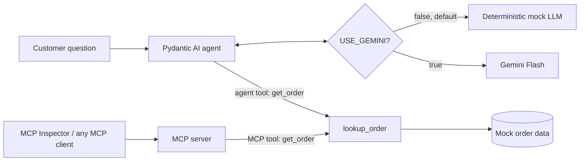

# Mini Support Agent: Pydantic AI + Gemini + MCP

In this workshop you build a tiny customer-support assistant that answers
"where is my order?" questions, and you expose the same order lookup as an
**MCP tool** that any MCP client can discover and call.

| Branch     | What it contains                                                    |
|------------|---------------------------------------------------------------------|
| `main`     | Student exercise. Three function bodies are `TODO`s for you to write. |
| `solution` | Complete, tested reference implementation. Peek only if stuck.      |

> **Nothing here is real.** The orders are invented mock data in a Python
> dictionary. No real orders are queried or changed, no emails are sent, and no
> payments or refunds happen.

## 1. What you will learn

- How an LLM agent calls a **Python tool** to get facts instead of guessing.
- How **Pydantic** forces the LLM to return a validated, structured answer.
- How to expose the same Python function as an **MCP tool**.
- How to discover and call that tool from the **MCP Inspector**.
- The difference between an agent's own tools and tools shared over MCP.

## 2. Architecture



The LLM **interprets and drafts**; Python supplies the **authoritative data**.
`lookup_order` in `order_data.py` is the only place order facts come from.

### Mock LLM first, then Gemini

`USE_GEMINI` in `.env` picks the LLM:

| `USE_GEMINI` | LLM | API key | Output |
|---|---|---|---|
| `false` (default) | Deterministic mock in `mock_llm.py` | Not needed | Same text every run |
| `true` | Gemini Flash | Needed | Wording varies between runs |

The mock is not a shortcut around your code. Like Gemini, it reads the order ID
from the question, **asks the agent to call `get_order`**, and builds the reply
from what the tool returns. If your tool or `lookup_order` is missing or wrong,
the mock fails too. Get everything working with the mock, then switch to Gemini.

### Agent tool vs MCP tool

| | Agent tool (`agent.py`) | MCP tool (`server.py`) |
|---|---|---|
| Who can call it | Only this one Pydantic AI agent | Any MCP client: Inspector, Claude Desktop, IDEs, other agents |
| How it is wired | A Pydantic AI tool decorator on the agent; called in-process | The MCP server's tool decorator; called over the MCP protocol (stdio here) |
| Needs an LLM key | Only when `USE_GEMINI=true` | No, it only returns mock data |

Both call the same `lookup_order`, so there is one dataset and one copy of the
business logic.

## 3. Project layout

```text
src/mini_support_agent/
  order_data.py   mock orders + lookup_order()          (TODO 1 on main)
  agent.py        Pydantic AI agent, SupportReply model (TODO 2 on main)
  mock_llm.py     deterministic mock LLM (no key needed)
  server.py       MCP server exposing get_order         (TODO 3 on main)
tests/
  test_order_data.py   deterministic tests for lookup_order
  test_agent.py        offline agent tests + live Gemini tests (-m live)
  test_server.py       MCP protocol tests (in memory and over stdio)
```

## 4. Prerequisites

- Python 3.11 or newer (`python --version`).
- GitHub Codespaces (recommended; Python and Node.js are preinstalled) **or** local Python.
- Node.js 18+ for the MCP Inspector (`node --version`). Not needed for the agent itself.
- A Google account for a free Gemini API key (only for the final Gemini step).

## 5. Create `.env`

```bash
cp .env.example .env
```

It starts with `USE_GEMINI=false`, so everything runs on the mock LLM and no
key is needed yet.

## 6. Switch to Gemini (when your instructor says so)

1. Open [Google AI Studio](https://aistudio.google.com/apikey), sign in, click
   **Create API key**, and copy it.
2. In `.env`, paste the key and turn Gemini on:

```dotenv
USE_GEMINI=true
GEMINI_API_KEY=your_key_here
```

Optional: add `GEMINI_MODEL=...` to use a different Gemini model (default `gemini-2.5-flash`).

> **Security warning:** never commit or share an API key. `.env` is in
> `.gitignore` so Git ignores it. Do not paste keys into chat, screenshots,
> issue trackers, or source code. If a key leaks, delete it in AI Studio and
> create a new one.

## 7. Install

```bash
python -m venv .venv
source .venv/bin/activate          # Windows: .venv\Scripts\activate
python -m pip install --upgrade pip
pip install -e ".[dev]"
```

## 8. Run the agent

```bash
python -m mini_support_agent.agent
python -m mini_support_agent.agent "Can you check order ord-102?"
```

With the mock LLM (`USE_GEMINI=false`) you get exactly this:

```text
Model: mock LLM (set USE_GEMINI=true in .env for Gemini)
Customer: Hi, my order ORD-101 still hasn't arrived. What's going on?

{
  "order_id": "ORD-101",
  "status": "delayed",
  "explanation": "Order ORD-101 (Mechanical keyboard) is delayed. Estimated delivery: 2026-10-30 (originally 2026-10-24; courier backlog).",
  "suggested_reply": "Thanks for your patience! Your Mechanical keyboard (order ORD-101) is delayed. Estimated delivery: 2026-10-30 (originally 2026-10-24; courier backlog)."
}
```

With Gemini (`USE_GEMINI=true`) the first line says `Model: Gemini` and the
wording changes from run to run, but `order_id` and `status` come from the mock
data and should not:

```text
{
  "order_id": "ORD-101",
  "status": "delayed",
  "explanation": "Order ORD-101 for a Mechanical keyboard is delayed due to a courier backlog. The new estimated delivery date is 2026-10-30.",
  "suggested_reply": "Hi! Your Mechanical keyboard (ORD-101) is delayed due to a courier backlog. The new estimated delivery date is 2026-10-30. We apologise for the inconvenience."
}
```

Try an unknown order such as `ORD-999`: the status should be `not_found`.

## 9. Run the tests

Offline tests (mock LLM, no API key, no cost):

```bash
pytest
```

Live Gemini smoke test (always uses Gemini, whatever `USE_GEMINI` says; needs your
key and makes about 4 API requests):

```bash
pytest -m live -v
```

The live test checks that Gemini called `get_order`, that the reply validates as
`SupportReply`, that `order_id` and `status` match the mock data, and that the
key never appears in the output.

## 10. Run the MCP server and test it in the MCP Inspector

The server uses the **stdio** transport: the client starts it as a subprocess
and talks to it over stdin/stdout. Running it alone just waits for input.

**Inspector web UI:**

```bash
npx @modelcontextprotocol/inspector .venv/bin/python -m mini_support_agent.server
```

Open the URL it prints, click **Connect**, go to **Tools → List Tools**, pick
`get_order`, enter `ORD-101`, and click **Run Tool**. You should see the
delayed keyboard order. Try `ord-999` too.

**Inspector CLI** (handy in Codespaces or if the browser UI will not connect):

```bash
npx @modelcontextprotocol/inspector --cli .venv/bin/python -m mini_support_agent.server --method tools/list
npx @modelcontextprotocol/inspector --cli .venv/bin/python -m mini_support_agent.server \
  --method tools/call --tool-name get_order --tool-arg order_id=ORD-101
```

## 11. Exercise (branch `main`, about 25 minutes)

1. Set up: steps 5 and 7 above (mock LLM, no key). Run `pytest` and notice which tests fail.
2. **TODO 1** in `order_data.py`: implement `lookup_order`. Run
   `pytest tests/test_order_data.py` until it passes.
3. **TODO 2** in `agent.py`: register the `get_order` agent tool. Run
   `pytest tests/test_agent.py`, then `python -m mini_support_agent.agent`.
4. **TODO 3** in `server.py`: expose `get_order` as an MCP tool. Run
   `pytest tests/test_server.py`, then open it in the MCP Inspector (step 10).
5. Switch to Gemini (step 6), run `python -m mini_support_agent.agent` again
   and compare its wording with the mock's. Finish with `pytest -m live -v`.

### TODO checklist

- [ ] `lookup_order` strips spaces, upper-cases the ID, returns a copy of a known order, and returns `{"order_id": ..., "status": "not_found"}` for unknown IDs.
- [ ] `get_order` is registered on `support_agent` as a tool and returns the shared lookup's result.
- [ ] `get_order` is registered on `mcp_server` as an MCP tool and returns the shared lookup's result.
- [ ] `pytest` passes (17 tests).
- [ ] The agent answers ORD-101 with the mock LLM.
- [ ] `get_order` shows up and runs in the MCP Inspector.
- [ ] With `USE_GEMINI=true`, the agent answers ORD-101 and `pytest -m live -v` passes (2 tests).

### Which test failures are expected on `main`

Before you finish the TODOs, these fail on purpose, each with a hint message:

| TODO | Failing tests |
|---|---|
| 1 `lookup_order` | all of `test_order_data.py`; the four TODO 2 tests below; `test_mcp_tool_uses_shared_lookup`, `test_server_works_over_stdio` |
| 2 agent tool | `test_get_order_tool_is_registered`, `test_agent_tool_uses_shared_lookup`, `test_mock_llm_answers_from_tool_data` (3 cases), `test_mock_llm_is_deterministic` |
| 3 MCP tool | all of `test_server.py` |

Three setup tests should pass from the start: `test_missing_api_key_gives_helpful_error`,
`test_mock_llm_is_the_default` and `test_use_gemini_switches_to_gemini`. If one
fails, your setup is wrong, not your TODO code.

## 12. You are done when

- `pytest` prints `17 passed, 2 deselected`.
- `python -m mini_support_agent.agent` prints `"status": "delayed"` for ORD-101, first with the mock LLM, then with Gemini.
- The MCP Inspector lists `get_order` and returns the ORD-101 record.
- `pytest -m live -v` prints `2 passed`.

## 13. Troubleshooting

| Problem | Fix |
|---|---|
| `GEMINI_API_KEY is not set` | You set `USE_GEMINI=true` (or ran `pytest -m live`) without a key. Paste your key into `.env`, or set `USE_GEMINI=false` to use the mock. |
| `Mock LLM: the agent has no get_order tool` | Finish TODO 2: the mock calls `get_order` just like Gemini would. |
| Output says `Model: mock LLM` but you wanted Gemini | Set `USE_GEMINI=true` in `.env` (in the project root) and save the file. |
| `Gemini API error 400` / `403` | The key is wrong or disabled. Create a new one in AI Studio. |
| `Gemini API error 429` | Free-tier limit (about 5 requests per minute for `gemini-2.5-flash`; each agent run uses 2). Wait a minute. |
| `Gemini API error 503` or timeouts | Gemini is overloaded. Retry, or set `GEMINI_MODEL=gemini-3-flash-preview` (or `gemini-3.5-flash-lite`) in `.env`. |
| Network errors | Check your internet connection or proxy; Codespaces needs no extra setup. |
| `ModuleNotFoundError: mini_support_agent` | Activate the venv and run `pip install -e ".[dev]"` from the project root. |
| `No module named 'mcp.server.fastmcp'` | You followed an MCP SDK v1 tutorial. This project uses SDK v2, where it is `from mcp.server import MCPServer`. |
| `npx: command not found` | Install Node.js 18+ (preinstalled in Codespaces). |
| Inspector UI will not connect in Codespaces | Use the Inspector CLI commands in step 10, or make sure ports 6274 and 6277 are forwarded. |
| Status is `not_found` for a real-looking ID | Only `ORD-100`, `ORD-101` and `ORD-102` exist. Unknown IDs are meant to return `not_found`. |
| Pydantic AI prints a large banner | Harmless. The agent module hides it with `PYDANTIC_AI_NO_BANNER=1`. |

## 14. Extensions

- Add an order with status `cancelled` and update `SupportReply.status`.
- Add a second MCP tool, e.g. `list_orders`, and see it appear in the Inspector.
- Connect the agent to the MCP server instead of the in-process tool, using
  Pydantic AI's MCP client support.
- Add the server to Claude Desktop or your IDE's MCP settings.

## 15. What is real and what is not

- **Real:** the Gemini API calls (when `USE_GEMINI=true`), Pydantic validation, the MCP protocol and Inspector.
- **Mocked:** the LLM by default (`USE_GEMINI=false`), and every order. No real orders, customers, shipments, refunds, or emails exist or happen.
